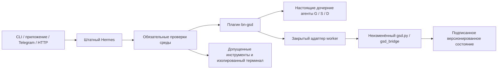

# Устройство интеграции

## Канонические источники

Единая поставка 1.1.0: SHA-256 `1f57161f3a6957729a656860b85d4759f2f75f6dd9bf35700572b63cbf2f30a0`; 285 файлов, 283 записи внешнего манифеста и 139 записей манифеста движка. Первые 30 документов совпали побайтово с документами единого пакета. Проверены целостность ZIP, пути, отсутствие опасных ссылок и контрольные суммы. Исходные `gsd.py`, `gsd_bridge/`, `engine/` сохранены; история хранится как источник происхождения и не включается в действующий контекст. Отдельный исходный Lab Adapter 1.2 отсутствует. Commit и файл лицензии GSD поставщиком не представлены.

## Путь исполнения

Плагин использует подтверждённые интерфейсы Hermes: `register_hook`, `register_middleware`, `register_skill`, `register_tool`, `subagent_lifecycle`, `register_terminal_environment_provider`. Когда обязательного блокирующего интерфейса в установленном ядре не оказалось, добавлен универсальный `register_execution_control`; код GSD в ядро не внесён. Контроль выполняется у фактического обработчика или запроса к поставщику модели после преобразований аргументов. При отсутствии, отказе или превышении времени контроля зависимый путь закрывается. Результат инструмента также проходит обязательный учёт до передачи модели.

## Разделение G/S/D

G действительно порождает поле кандидатов; структурный адаптер не сочиняет гипотезы. S получает поле кандидатов, наблюдения и исходное программное сравнение. D получает результат S и типизированную передачу, сохраняя неопределённости. Исходный конечный алгоритм сравнивает только предъявленные ключи; он не доказывает истинность наблюдений или причинность. Переданные продукты регистрируются исходными `ProductRegistry` и `HandoffChannel`, имеют версии, отпечатки, происхождение, профиль риска, срок и общий ресурс.

Роли запускаются через штатную службу дочерних агентов, с пустым набором внешних инструментов и запретом повторного делегирования. Их идентичность связывает доверенное событие Hermes с закрытой записью задания. Произвольный текст входа не создаёт роль или полномочие. Завершение подтверждается результатом реального исполнителя; неизвестный исход остаётся неизвестным.

## Контекст и каталог

1 948 адресов: 152 процедуры, 37 протоколов, 31 листовая операция, 1 728 исходных элементов. Навыки: 220 полных операций, указатель и оркестрация. Каталог загружается адресно; не помещается целиком в постоянный запрос модели. Исходный сборщик включает обязательное ядро и замыкание зависимостей. Для процедуры дополнительно извлекаются её входы, ссылки и принятые выходы зависимостей. Полные байты и отпечатки проверяются перед запросом модели.

При превышении границы задача отклоняется или разделяется на независимые операции с полным обязательным контекстом каждой. `gsd_work_file` фиксирует исходный файл, все индексы и фактическое покрытие; общий вывод по частям не разрешается автоматически. Сжатие контекста отключено; режим работы с кодом `auto` сохраняет доступ к GSD вместо скрытия расширения режимом `focus`.

## Доверенное состояние и ресурс

Состояние хранится в исходном подписанном Store. Независимая закрытая опорная запись связывает контрольную сумму базы и версию движка. Старый снимок, отсутствующий ключ, несовпадение опорной записи или исходников переводят зависимый путь в отказ. Семьи владеют случаями и продуктами; переход к чужой семье требует решения оператора и объединяет расход без его обнуления.

Начальные ограничения семьи: 4 000 000 токенов, 64 запроса модели, 32 дочерних задания, 7200 секунд; ответ до 4096 токенов, аргументы запроса до 2 МиБ. Резервирование предшествует запросу, известный расход учитывается после него, неизвестный расход не возвращается. Дочерние и вспомогательные запросы используют тот же ресурс. При гибели процесса незавершённый запрос учитывается консервативно по верхней границе, семья приостанавливается; продолжение требует оператора. Восстановленные разговоры привязываются перед запросом модели, даже если Hermes не повторяет событие начала сеанса.

## Прежние инструменты

425 конкретных операций MCP допущены явным каталогом; добавлены штатные поиск/чтение и существующий Nimble. Сверяются сервер, транспорт и отпечатки местных переходников. Неизвестная операция не получает допуск по своему названию или заявлению сервера. Публикация, выделенное удаление и другие защищённые операции требуют точного краткосрочного разрешения владельца; оно связывает семью, метод и аргументы, расходуется до действия и не повторяется после неизвестного исхода.

Местный терминал и R изолированы средствами macOS. Разрешены рабочие файлы и необходимые библиотеки; закрыты сеть, ключи, служебное состояние GSD, запись вне допущенных каталогов и доступ к чужим процессам. Обычный терминал не служит обходом контролируемых MCP. Beads остаётся общим средством учёта работы Hermes и используется через его настроенный MCP.
